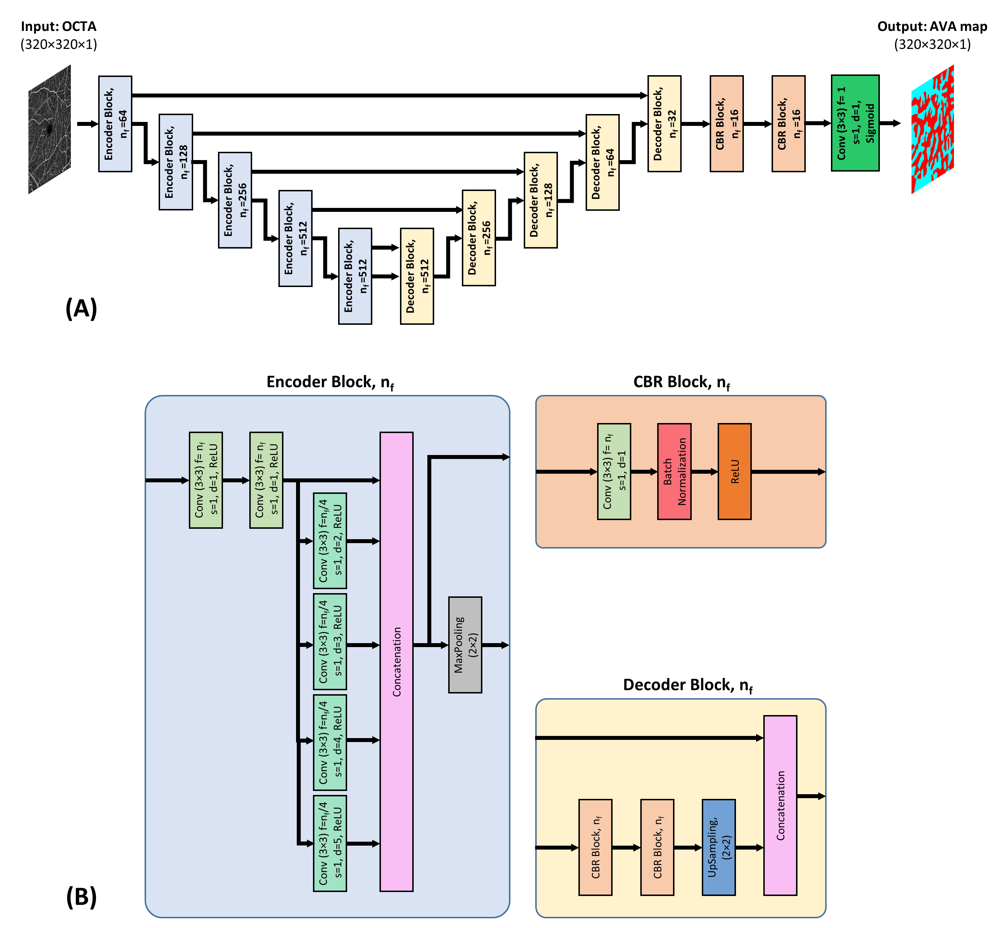
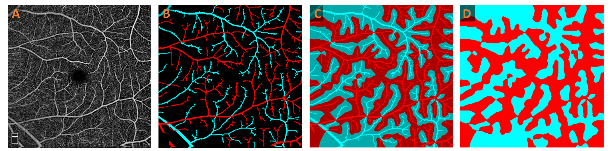

# AVA-Net

**Deep Learning for Arterial-Venous-Area (AVA) Segmentation using OCTA images**  
Implementation in Python and TensorFlow.

---
## Overview

In this project, we present a fully convolutional network (FCN), AVA-Net, a U-Net-like architecture, for fully automated arterial-venous area (AVA) segmentation using OCT-angiography (OCTA) images. The AVA-Net architecture is illustrated below



Images were acquired using the AngioVue SD-OCT device (Optovue, Fremont, CA, USA). The OCT system had a 70,000 Hz A-scan rate with ~5 μm axial and ~15 μm lateral resolutions. All OCTA images used for this study were 6 mm × 6 mm scans; only superficial OCTA images were used. 

Figures (A) and (B) show a representative OCTA image and corresponding manually generated artery-vein (AV) map. For generating AVA maps, the k-nearest neighbor (kNN) classifier is used to classify background pixels as pixels in arterial or venous areas. The output of the kNN classifier is presented in Figure (C) with a lighter tone of blue and red compared to arteries and veins presented in Figure (B). The union of the arteries and veins with corresponding arterial and venous areas generates the AVA maps represented in Figure (D).


---

## Features

- **AVA-Net Model**: U-Net-like deep learning architecture for AVA segmentation.
- **Custom Loss**: IoU-based loss function for robust training.
- **Data Augmentation**: Integrated using `ImageDataGenerator`.
- **Configurable Training**: Easily adjustable parameters in `config.py`.


---

## Project Structure

```
AVA-Net/
├── training.py # Main training script
├── config.py # Configuration file
├── loss.py # Custom IoU loss and metrics
├── AVA_Net.py # AVA-Net model definition
├── requirements.txt # Python dependencies
├── train_data.csv # Mapping input images to masks
└── Dataset/
├── Train Input/ # RGB input images
└── Train Output/ # Grayscale mask images
```

---

## Dependencies

Requires **Python 3.7+**. Install dependencies:

```bash
pip install -r requirements.txt
```

## How to Run Training

### 1. Prepare Dataset

#### Dataset Structure
* Place RGB input images in `Dataset/Train Input/`
* Place grayscale mask images in `Dataset/Train Output/`
* Create a CSV file (default: `train_data.csv`) mapping inputs to outputs

#### CSV Format
The `train_data.csv` file must contain two columns:
* `Input`: Filename of the RGB input image (e.g., `image001.png`)
* `AV`: Filename of the corresponding grayscale mask (e.g., `mask001.png`)

Example CSV content:
```csv
Input,AV
image001.png,mask001.png
image002.png,mask002.png
image003.png,mask003.png
```

#### Image Requirements
* **Input images**: RGB format (`.png`, `.jpg`, `.tif` supported)
* **Mask images**: Grayscale format with pixel values in range [0, 1] or [0, 255]
* Images can be any size; they will be resized to the dimensions specified in `config.py`

### 2. Configure Parameters

Edit `config.py`:

* `IMAGE_HEIGHT`, `IMAGE_WIDTH`
* `MAX_EPOCHS`, `BATCH_SIZE`
* `PARENT_DIR` (if needed)

### 3. Start Training

```bash
python training.py
```

---

## Trained Weights

To request trained AVA-Net weights, contact:

**Prof. Xincheng Yao**
📧 [xcy@uic.edu](mailto:xcy@uic.edu)
Include your study details in the email.

---

## Paper

Read the full paper:
🔗 [Nature Communications Medicine](https://www.nature.com/articles/s43856-023-00287-9)

---

## Citation

If you use this project, please cite:

```bibtex
@article{Abtahi2023AVANet,
  title={An open-source deep learning network AVA-Net for arterial-venous area segmentation in optical coherence tomography angiography},
  author={Abtahi, Mansour and Le, David and Ebrahimi, Behrouz and Dadzie, Albert K. and Lim, Jennifer I. and Yao, Xincheng},
  journal={Communications Medicine},
  volume={3},
  pages={54},
  year={2023},
  publisher={Nature Publishing Group UK London},
  doi={10.1038/s43856-023-00287-9}
}
```
